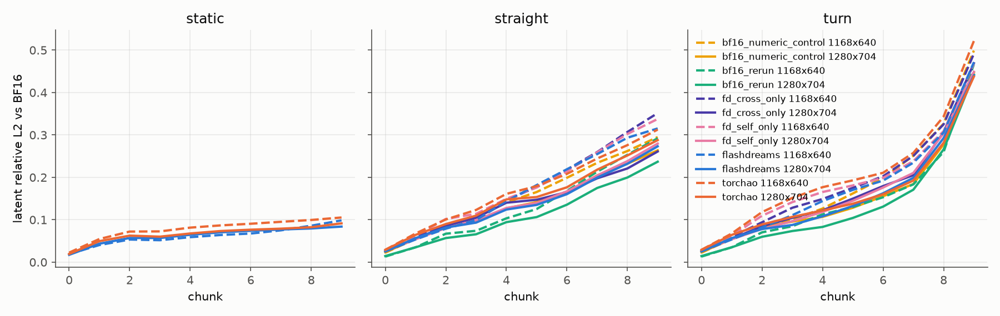

# Model-level validation for NVIDIA/flashdreams#696

These are real OmniDreams rollouts with FP8 attention output projections, measured against BF16 run-to-run noise.

- Whole-pipeline throughput improves by +0.2–0.3% only.
- The absolute short-clip quality gates fail for an unchanged BF16 rerun as well, so they cannot judge FP8.
- Measured against six BF16 reruns, FP8 adds a consistent but modest error: MAE is 1.2–1.3× the BF16-rerun median on moving sequences and 1.5–1.7× on static ones.

## Contents

- [REPORT.md](REPORT.md): scope, method, results, limits, and the unrelated `ptxas` infrastructure failure.
- `data/`
  - [noise-band.csv](data/noise-band.csv): gate metrics for every scored short rollout. It records whether each rollout falls inside the BF16 band, computed leave-one-out for BF16 members.
  - [quality-ablation.csv](data/quality-ablation.csv): absolute-gate results for the FP8 runs and the round-2 ablations.
  - [latent-drift.csv](data/latent-drift.csv), [latent-drift-round2.csv](data/latent-drift-round2.csv): per-chunk relative L2 and cosine of the model output, plus RGB MAE, against BF16.
  - [per-layer-error.csv](data/per-layer-error.csv): teacher-forced FP8 error for all 56 output projections across 10 chunks.
  - [noise-band-bitwise.json](data/noise-band-bitwise.json): bitwise reproducibility of BF16 reruns, with and without a shared compile cache.
  - [pipeline-throughput.csv](data/pipeline-throughput.csv): 108 Slurm pipeline processes. Each row carries p50/p90, FPS, memory, and startup.
  - [ptxas-stress.csv](data/ptxas-stress.csv), [ptxas-mechanism.json](data/ptxas-mechanism.json), [matrix-runs.csv](data/matrix-runs.csv): the infrastructure investigation and the process list.
- [scripts/](scripts): the measurement drivers. They import an unpublished frozen harness (the round-1 pipeline builder and its assets), so they document the method but are not standalone.

## Environment

- Hardware: one Slurm node with 2× NVIDIA B200, one resolution per GPU.
- Software: Python 3.12.13, PyTorch 2.12.1+cu130, torchao 0.18.0, Triton 3.7.1, driver 580.126.20.
- Frozen PR head: `10fd89b9427b0d4b5233175b717faf926f9259da`.

## Redaction

This public export removes local absolute paths, host names, user names, cluster partition and account names, and GPU UUIDs. Numeric observations are unchanged.

The redaction markers are `<REPO>`, `<HOME>`, `<TMP>`, `<USER>`, `<B200-node>`, `<dev-host>`, `<login-node>`, `<slurm-epilog-dir>`, `<PARTITION>`, `<ACCOUNT>` and `<GPU-UUID>`.

Not published: checkpoints, conditioning inputs, generated videos/RGB/latents, compiler caches, and raw per-process logs. Generated data and charts accompany the repository's license.
